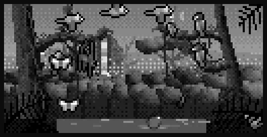
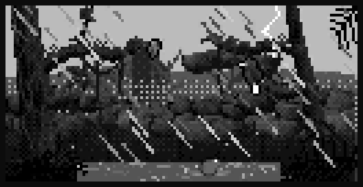

# rainforest

A rainforest for norns, alive. Rain that comes and goes, birds at first light,
monkeys, frogs after the rain, a jaguar on the bank at night, storms passing
over — and on the screen, the forest it all comes from, through the hours of
the day.

## Install

- **norns-js**: open the scripts store (the bag button, top right), find it on the *made for
  norns-js* shelf, press **get**, then **restart** when the page asks.
- **norns**: in maiden, `;install https://github.com/pinktentacle/rainforest`,
  then SYSTEM > RESTART once so its engine is loaded.

## Play

| | |
|---|---|
| E1 | the hour |
| E2 | choose a setting |
| E3 | change it |
| K2 | weather: *living* (showers come and go by themselves) or *still* |
| K3 | lightning, now |

The settings: rain, wind, thunder, birds, monkeys, jaguar, woodpecker,
cicadas, insects, frogs, stream, waterfall, drips, variety (how many kinds of
animals) and space (reverb). The screen says under each one what it does.
A grid, if there is one, has a fader for each.

## Credits

The sounds are field recordings in the public domain (CC0) from
[Freesound](https://freesound.org). Thank you to everyone who recorded them:

| | |
|---|---|
| rain | trundlefly (349328), nonzeroenfilade (172099), Victormaa (671409) |
| insects, cicadas | simous00 (852877), kyles (450537), laughatlantic (320113) |
| frogs | felix.blume (868747), loganzsound (784150), Traviow (687212) |
| water, wind | Yuval (197023), marc.om (806570), kyles (637563) |
| thunder | bastipictures (243782), BlondPanda (778374), Emulius (744722), elmoustachio (476739) |
| birds | trundlefly (349327), felix.blume (376827, 504988, 512109), craigsmith (675966), vialgames (557837), marc.om (426274), zachrau (812932), dedakoo (468232), Breviceps (465697), dandman3039 (528623), nonamethefish (798321), tubbers (194772), a deleted account (532268) |
| monkeys | franciscoguerrero (232748), TheKingOfGeeks360 (850013, 843477, 871018) |
| woodpecker | wjoojoo (187860, 187861), a deleted account (677524) |
| jaguar | craigsmith (675497) — another big cat's growl |

The numbers are Freesound ids: freesound.org/s/&lt;id&gt;.

Code and pictures: MIT, see [LICENSE](LICENSE).
